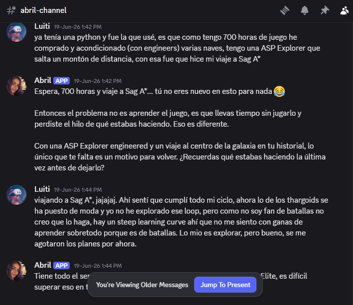
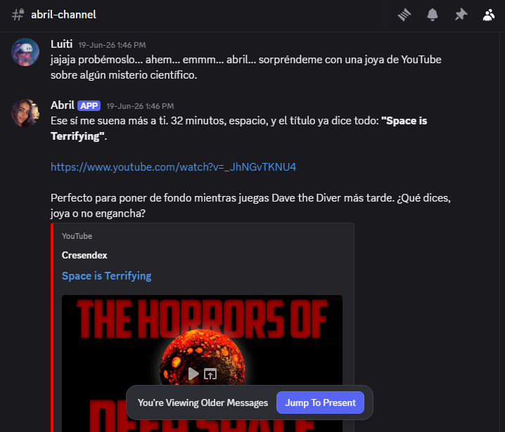

## Por qué la hice

Quería un solo lugar donde preguntar por mi agenda, mi correo, mis gastos y el próximo autobús a casa, y quería que me respondiera como una persona. Así que en junio de 2026 creé a Abril y le di una Raspberry Pi 4 en mi salón, funcionando todo el día como servicio del sistema.

*Una conversación normal en Discord, junio de 2026. Sabía a qué juego y me hizo la pregunta que haría un amigo.*

## Versión 1: cinco agentes en una semana

La primera versión era un pequeño equipo. Abril hacía de orquestadora y cuatro especialistas tenían su propio bot de Slack: uno para correo, calendario y YouTube, otro para investigar, otro para el dinero (lee fotos de tickets y los apunta en una hoja de cálculo) y otro para notas de salud. Cada especialista era un bucle de herramientas de Claude que Abril llamaba como cualquier otra herramienta. Abril usaba Claude Sonnet y subía a Opus para las peticiones difíciles. Los especialistas usaban Haiku.

Alrededor de eso añadí memoria a largo plazo con pgvector y embeddings de Voyage, resúmenes de sesión, recordatorios, horarios de autobús en tiempo real para Valencia, voz de entrada y salida con ElevenLabs y un modo proactivo en el que ella empezaba las conversaciones. Fueron 72 commits en siete días.

Muchos de esos commits eran ajustes de prompt. El modelo prefería responder de memoria antes que llamar a una herramienta, así que escribí reglas que obligan a usarla. Una herramienta se llamaba `list_google_tasks` y el modelo la confundía con algo que conocía de su entrenamiento. Cambiarle el nombre a `get_pending_tasks` lo resolvió. Detalles así son la mayor parte del trabajo.

## La auditoría

Antes de seguir añadiendo cosas, hice auditar el código de arriba abajo. Salieron problemas reales: bucles de herramientas sin límite, recordatorios que podían repetirse o perderse tras un reinicio, un paso de confirmación que solo existía en el prompt y ninguna comprobación de quién hablaba con el bot. También quedó claro que mis cinco agentes eran cinco envoltorios del mismo cliente de la API. La delegación costaba dinero y tiempo, y no aportaba nada.

## Versión 2: un solo agente, más seguro

La versión 2 juntó el equipo en un único agente que conserva todas las herramientas. Añadí prompt caching en las herramientas y en el prompt de sistema, registro del consumo de tokens por llamada y tests de regresión (80 en verde al cerrar la versión). Las contraseñas y los documentos pasaron a un baúl cifrado local que se revisa antes de que el modelo vea el mensaje, así un secreto nunca llega a un prompt, a la memoria ni a un log. Las herramientas externas entran por un cliente MCP que corre como subproceso sin claves de API en su entorno. Discord se sumó a Slack como segunda forma de hablar con ella. También ganó un curador local de YouTube que guarda mi historial de gustos en SQLite, tiene en cuenta mis opiniones y sugiere un vídeo por turno.

*Le pido un vídeo de ciencia y elige uno, con el motivo por el que encaja.*

Esta versión la construí con OpenAI Codex. Trabajar el mismo código con dos agentes distintos me enseñó mucho sobre lo que cada uno necesita en sus instrucciones.

## Versión 3: fuera de la Pi y dentro de la suscripción

En septiembre la Pi dejó de arrancar. Rescaté su SSD desde WSL y aproveché para cambiar dos cosas. Abril se mudó a mi portátil con Windows, y pasó de claves de API de pago por uso a mi suscripción de Claude a través del Claude Agent SDK. Sus herramientas ahora corren como un servidor MCP dentro del mismo proceso y las herramientas propias de Claude Code para la terminal y los archivos están desactivadas, así que solo puede hacer lo que sus herramientas permiten. Los bucles se detienen en ocho pasos. Un lanzador en PowerShell arranca Docker, espera a Postgres, la reinicia con esperas crecientes y quita las claves de API del entorno para que siempre use la suscripción.

También quité funciones a propósito. La imagen de portada muestra el antiguo modo proactivo: un recordatorio del día siguiente y una sugerencia de vídeo que mandó sin que se la pidiera. Ya no escribe ella primero y solo habla en voz alta cuando se lo pido. Es la versión que uso cada día.

## Lo que me llevo

La versión 1 me enseñó lo que un asistente puede hacer. La versión 2 decidió lo que debería tener permitido. Un diagrama con cinco agentes queda mejor en una presentación, y un solo agente bien acotado funciona mejor en la vida real.
